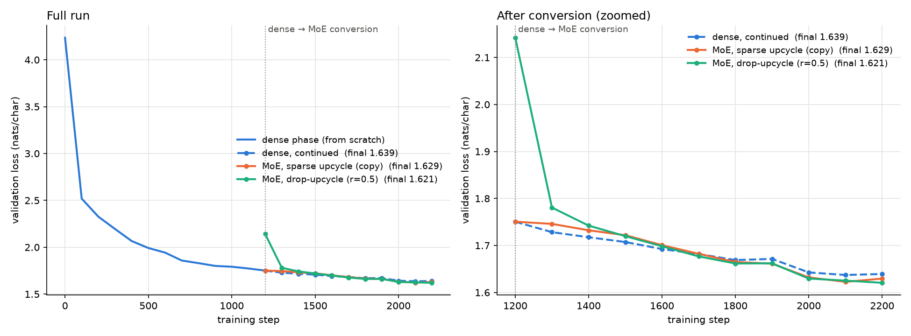
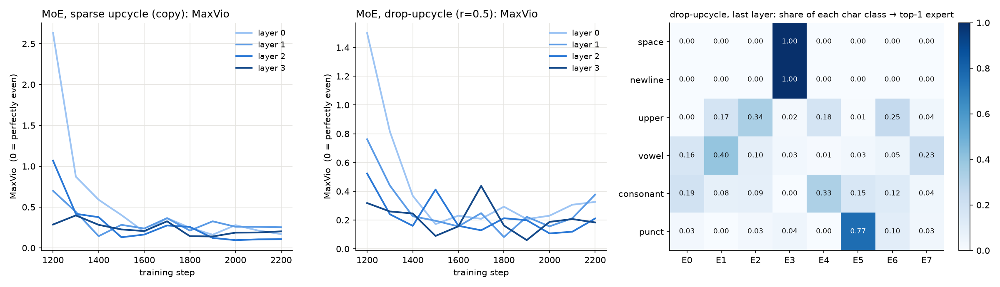

# Session 14: Dense → Mixture-of-Experts by upcycling

A small dense transformer is trained from scratch and then converted into a Mixture-of-Experts (MoE) model. The MoE continues training and keeps reducing loss. Everything runs on a CPU in about 45 minutes.



## What was done

| stage | details |
|---|---|
| Data | Tiny Shakespeare (1.1M chars), character level, vocab 65, 90/10 train/val split |
| Dense model | GPT with 4 layers, d_model 128, 4 heads, context 64, **SwiGLU FFN of width 512**, tied embeddings. **1.07M params** |
| Dense training | 1,200 steps from scratch, batch 32×64, AdamW lr 1e-3, 100-step warmup |
| Conversion | Every FFN is replaced by a **router + 8 experts, top-2**. Each expert is initialised from that layer's dense FFN |
| Continued training | 1,000 more steps for each of three branches that start from the **same** dense checkpoint |

### The two upcycling methods (Section 15 of the lesson)

- **Sparse upcycling (`moe-copy`).** All 8 experts are exact copies of the dense FFN. The router starts at about zero (std 1e-3), and the top-2 weights are renormalised to sum to 1. Because of that, the MoE computes **exactly the dense function at conversion**: val loss is 1.75055 before and 1.75055 after.
- **Drop-upcycling, r = 0.5 (`moe-drop`).** Each expert is a copy with 50% of its inner neurons redrawn from the dense weights' own mean and std. The experts start different from each other, which costs a loss jump at conversion (1.75 → 2.14) that is recovered within about 100 steps.

### MoE layer details (Sections 7, 12 and 13)

- Softmax router in fp32, top-2, weights renormalised (Qwen3 style). Routing is dropless: there is no capacity limit.
- **Aux-loss-free balancing.** Each expert has a selection bias that moves by a sign rule. It is used only to *choose* experts, never to *weight* them. γ = 5e-3, raised from the paper's 1e-3 because this run is short.
- A small Switch-style auxiliary loss, α = 1e-3, with load counted over the **whole batch** (Section 14).
- Size: **6.58M total / 1.86M active** params (8 experts stored, 2 used per token).

## Results

Validation loss in nats/char, averaged over 20 fixed validation batches:

| model | at conversion (step 1200) | step 1300 | step 1700 | **final (step 2200)** | train loss, final |
|---|---|---|---|---|---|
| dense, continued (baseline) | 1.751 | 1.728 | 1.682 | **1.639** | 1.443 |
| MoE, sparse upcycle (copy) | 1.751 | 1.746 | 1.682 | **1.630** | 1.425 |
| MoE, drop-upcycle (r=0.5) | 2.142 | 1.781 | 1.677 | **1.621** | 1.419 |

**Both MoE models keep training after conversion.** The copy MoE goes from 1.751 to 1.630 and the drop MoE from 2.142 to 1.621. Both finish below the dense model trained for the same number of steps.

The copy MoE improves slowly for its first ~100 steps. Its experts are identical, so the router has nothing to tell them apart until gradient noise makes them diverge. The drop MoE starts worse, but after ~300 steps it overtakes the other two and ends lowest. This matches the drop-upcycling paper's finding that experts which start different learn better.

### Routing health



- **Balance.** MaxVio starts high, up to 2.6 in layer 0 of the copy MoE, where one expert takes about 3.6× its fair share. The bias and aux loss bring it down to **0.1–0.4 in every layer**. No expert died in any layer (dead = under 10% of the average load).
- **Specialisation (right panel, last layer of the drop MoE).** The router learned **token-type experts**, as described in Section 9:
  - expert 3 takes **100% of spaces and newlines**
  - expert 5 takes **77% of punctuation**
  - vowels, consonants and capitals are spread across the other six experts

### Samples at step 2200 (temperature 1)

```
dense:     AUTOLYCUS:
           'Siringht, the head in shuw dear ne.

moe-drop:  PAULINA:
           And My pour you framerer? hath not seem'd you.

           CLIFFORD:
           Nor you well exchange are forfence my father well stone.
```

## Caveats

- **Not compute-matched.** Each expert has full dense width (512), and a token uses 2 of them. The MoE therefore does about 1.75× the dense model's active parameters per token (1.86M against 1.07M) and has 6.2× the total. The claim here is that *the converted model keeps training and improves*, not that it wins at equal FLOPs. A compute-matched variant would split each FFN into 8 experts of width 64 with top-8 or similar (partition upcycling).
- **One seed, short run.** The final gaps between the three branches (0.01–0.02 nats) are about the size of the evaluation noise. Improvement over the conversion point is large and consistent, but the ranking between branches would need more seeds to confirm.

## Files

| file | purpose |
|---|---|
| `moe_upcycle.py` | model, dense training, `upcycle()` conversion, MoE training, specialisation analysis |
| `plot_results.py` | makes `outputs/loss_curves.png` and `outputs/routing.png` |
| `outputs/train_log.txt` | full console log |
| `outputs/all_logs.json`, `outputs/summary.json` | per-eval metrics (loss, per-expert load, MaxVio, dead count), specialisation table, samples |
| `outputs/*.pt` | dense, moe-copy and moe-drop checkpoints |

Reproduce with `python moe_upcycle.py && python plot_results.py`. The dense checkpoint is reused if `outputs/dense.pt` exists.
